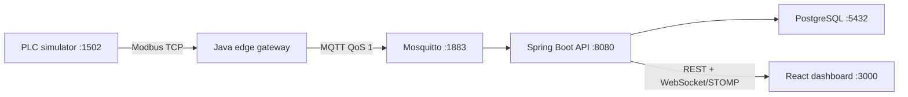

# Single Machine IoT Demo

> **Simulated Data** — this project illustrates an industrial telemetry architecture. It does not reproduce proprietary equipment logic and must never be used to control a real machine.

A runnable portfolio demonstration of telemetry flowing from a simulated oxygen-generation process through Modbus TCP, an edge gateway, MQTT, Spring Boot, PostgreSQL, WebSocket/STOMP, and a React dashboard.

## Architecture



## Quick start

```bash
cp .env.example .env
docker compose up --build
```

Open <http://localhost:3000>. OpenAPI is at <http://localhost:8080/swagger-ui.html> and simulator controls are at <http://localhost:8081/docs>.

| Service | Host port | Protocol |
|---|---:|---|
| Dashboard | 3000 | HTTP |
| Backend | 8080 | HTTP, WebSocket |
| PLC scenario API | 8081 | HTTP |
| PLC | 1502 | Modbus TCP |
| MQTT | 1883 | MQTT |
| PostgreSQL | 5433 | PostgreSQL (container port 5432) |

## Telemetry flow

The simulator updates seven holding registers and three coils each second. The edge gateway reads a complete snapshot, scales and validates values, assigns a durable sequence, writes it to SQLite, and publishes it at MQTT QoS 1. The backend validates and de-duplicates the envelope, writes JSONB history and latest state, evaluates alarms, and sends STOMP events. React loads authoritative snapshots over REST and applies live events between refreshes.

See the [register map](docs/modbus-register-map.md), [MQTT contract](docs/mqtt-contract.md), and OpenAPI UI at `http://localhost:8080/swagger-ui.html`.

## Scenarios and alarms

Use the dashboard **Scenarios** page or:

```bash
curl -X PUT http://localhost:8081/api/scenario/low-purity
curl -X PUT http://localhost:8081/api/scenario/normal
```

Low purity, high temperature, and pressure drop must remain abnormal for ten seconds before an alarm opens. Open alarms can be acknowledged; returning to normal clears them. Follow the [five-minute demo script](docs/demo-script.md) and [offline buffering test](docs/offline-buffering-test.md).

## Testing

```bash
PYTHONPATH=plc-simulator python -m pytest plc-simulator/tests
(cd edge-gateway && mvn verify)
(cd backend && mvn verify)
(cd frontend && npm ci && npm run lint && npm test && npm run build)
(cd frontend && npx playwright test) # requires a running stack
docker compose config --quiet
```

## Screenshots

Screenshots should be captured from the verified running stack and stored in `docs/screenshots/`. The dashboard itself is the source of truth; no static mockup is used for the process diagram.

## Optional AWS mode

Local operation requires no cloud account. The [AWS IoT Core guide](docs/aws-iot-core-setup.md) explains Thing identity, least-privilege policy, certificate mounts, and testing. Never commit AWS certificates, private keys, account IDs, or secrets.

## Troubleshooting

- If the dashboard says data is unavailable, wait for backend and edge health checks, then inspect `docker compose ps` and `docker compose logs SERVICE`.
- If port 1502, 1883, 3000, 5433, 8080, 8081, or 8082 is occupied, stop the conflicting local service or change the host-side mapping.
- If alarms do not appear, keep the abnormal scenario selected for more than ten seconds.
- If telemetry does not resume after an outage, confirm Mosquitto is healthy and inspect `http://localhost:8082/actuator/prometheus`.

## Security and production limitations

Local anonymous MQTT and display-name acknowledgements are demo-only. Review [security guidance](docs/security.md), the [storage ADR](docs/adr/001-telemetry-storage.md), and [multi-machine scaling](docs/scaling-to-multiple-machines.md) before adapting the design. A real PLC connection must be read-only, segmented, vendor-approved, and independently safety-reviewed.

## Future improvements

Add authenticated users and audit logs, external STOMP relay, time-partitioned telemetry retention, fleet configuration, richer state timelines, production TLS automation, and deployment-specific observability dashboards.

Contributions are welcome under [CONTRIBUTING.md](CONTRIBUTING.md); security reports follow [SECURITY.md](SECURITY.md).

## License

Apache-2.0.
