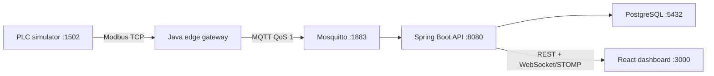

# Single Machine IoT Demo

> **Simulated Data** — this project illustrates an industrial telemetry architecture. It does not reproduce proprietary equipment logic and must never be used to control a real machine.

A runnable portfolio demonstration of telemetry flowing from a simulated oxygen-generation process through Modbus TCP, an edge gateway, MQTT, Spring Boot, PostgreSQL, WebSocket/STOMP, and a React dashboard.

## Architecture



## Quick start

```bash
cp .env.example .env
docker compose up --build
```

Open <http://localhost:3000>. OpenAPI is at <http://localhost:8080/swagger-ui.html> and simulator controls are at <http://localhost:8081/docs>.

| Service | Host port | Protocol |
|---|---:|---|
| Dashboard | 3000 | HTTP |
| Backend | 8080 | HTTP, WebSocket |
| PLC scenario API | 8081 | HTTP |
| PLC | 1502 | Modbus TCP |
| MQTT | 1883 | MQTT |
| PostgreSQL | 5432 | PostgreSQL |

Detailed operating, testing, security, AWS, and architecture guidance is under [`docs/`](docs/architecture.md).

## License

Apache-2.0.

